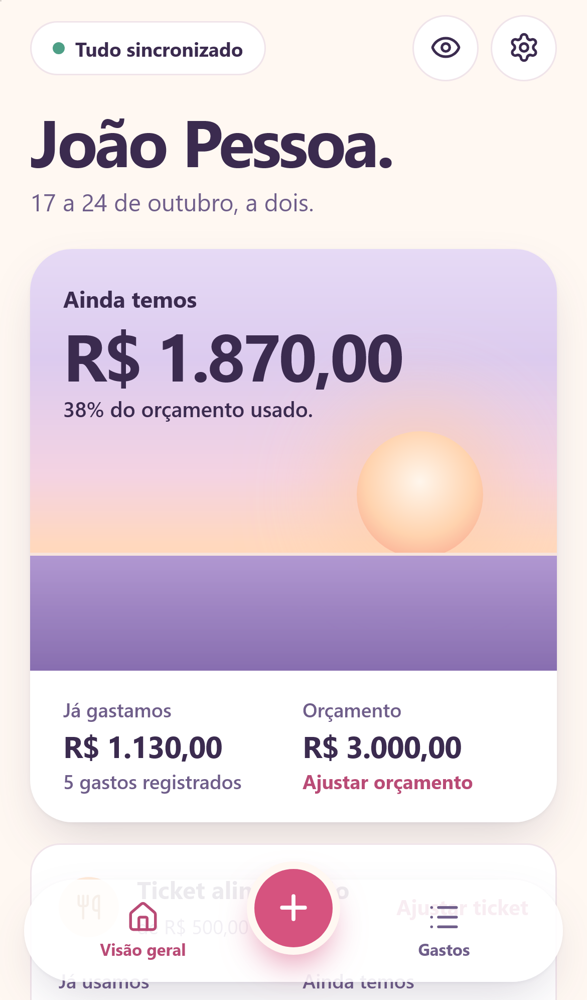
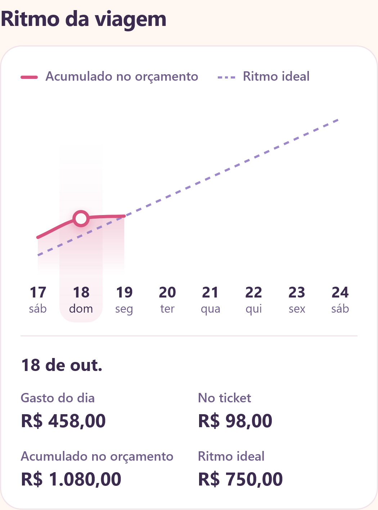
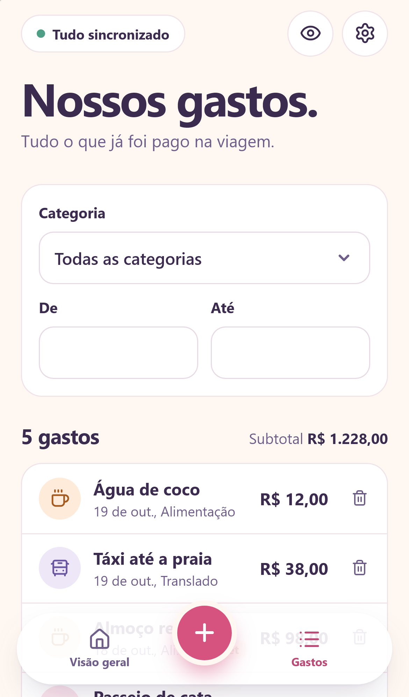
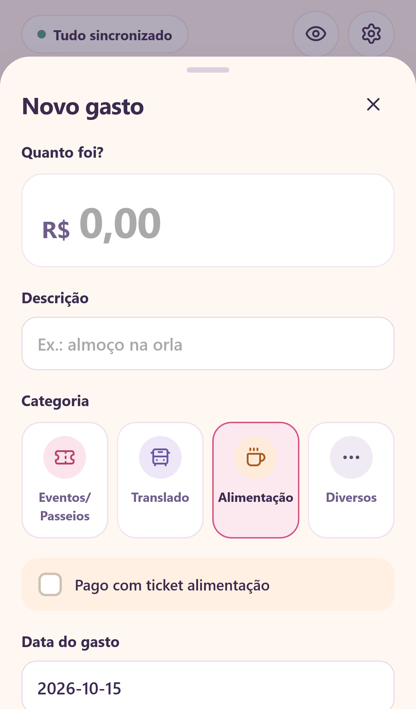
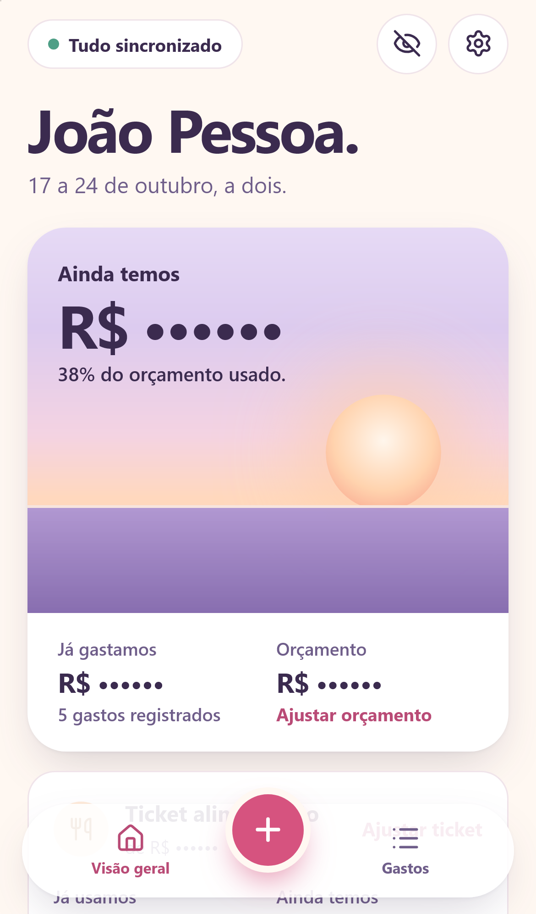

# João Pessoa a dois

Aplicativo web instalável (PWA) para um casal controlar os gastos de uma viagem, juntos, em dois celulares. Feito para a viagem de Ian e Lara a João Pessoa, de 17 a 24 de outubro de 2026: interface em português, valores em reais e datas no horário de Brasília.

Funciona sem internet: os gastos ficam salvos no aparelho e sincronizam sozinhos quando a conexão volta. Se o mesmo gasto for alterado nos dois celulares ao mesmo tempo, o app pede para escolher qual versão fica. Nada é sobrescrito em silêncio.

<p align="center">
  
  
  
</p>

> As capturas usam apenas dados fictícios do servidor de testes.

## Funcionalidades

- **Orçamento do casal**: um valor único para a viagem, com quanto já foi gasto e quanto ainda resta, inclusive saldo negativo.
- **Quatro categorias fixas**: Eventos/Passeios, Translado, Alimentação e Diversos.
- **Ticket alimentação**: um saldo à parte. Gastos de Alimentação marcados como "Pago com ticket alimentação" abatem só desse saldo.
- **Céu de fim de tarde**: no cartão principal, o sol desce conforme o orçamento é usado e se põe quando ele acaba.
- **Ritmo da viagem**: curva do gasto acumulado até hoje, comparada à linha do ritmo ideal (orçamento dividido pelos dias da viagem).
- **Ocultar valores**: o olho no topo troca todos os valores por `R$ ••••••`, como em apps de banco. Cada aparelho lembra a própria escolha.
- **Lista de gastos** com filtros por categoria e período, edição, exclusão confirmada e exportação em CSV.
- **Offline e sincronização**: cadastro e consulta sem internet, sincronização ao reconectar e a cada 10 segundos com o app aberto.
- **Conta compartilhada** por e-mail e senha, com sessão própria em cada aparelho. Não existe cadastro público.
- **Backup automático** diário do banco no servidor.

<p align="center">
  
  
  
</p>

## Tecnologias

| Parte | Escolhas |
|---|---|
| Interface | React 19, TypeScript, Vite, ícones Lucide, CSS próprio |
| App instalável | `vite-plugin-pwa` (Workbox): guarda só a interface, nunca dados privados |
| Dados no aparelho | IndexedDB via Dexie, com fila de alterações pendentes |
| Servidor | Node.js 24, Fastify, SQLite nativo (`node:sqlite`), senhas com Argon2id |
| Validação | Zod, compartilhada entre servidor e interface |
| Testes | `node:test` e Playwright (WebKit com perfil de iPhone) |
| Publicação | Docker Compose atrás de um proxy reverso com HTTPS (Traefik) |

## Começando

Requisitos: **Node.js 24** (o projeto usa o `node:sqlite` dessa versão) e npm.

```sh
npm ci
cp .env.example .env
npm run account:setup   # cria a conta local (a senha é pedida sem aparecer na tela)
npm run dev
```

Abra http://localhost:5173. O banco de desenvolvimento fica em `.data/`, separado de qualquer produção.

> No Windows/PowerShell, use `Copy-Item` no lugar de `cp`. Se a política do computador bloquear o `npm.ps1`, use `npm.cmd` e `npx.cmd`.

O guia completo de desenvolvimento, com variáveis de ambiente, testes e migrações, está em [docs/desenvolvimento.md](docs/desenvolvimento.md).

## Comandos

| Comando | O que faz |
|---|---|
| `npm run dev` | Servidor da API e Vite com recarga automática |
| `npm run build` | Checagem de tipos (inclui os testes) e build de produção com service worker |
| `npm start` | Sobe o servidor servindo o build de `dist/` |
| `npm test` | Testes de lógica, API, backup e sincronização |
| `npm run test:e2e` | Jornadas completas no navegador (WebKit, perfil iPhone) |
| `npm run account:setup` | Cria ou redefine a conta compartilhada, de forma interativa |
| `npm run backup` | Faz um backup consistente do banco |
| `npm run restore -- ARQUIVO.db --server-stopped` | Restaura um backup, com o servidor parado |

## Documentação

| Documento | Conteúdo |
|---|---|
| [docs/arquitetura.md](docs/arquitetura.md) | Componentes, modelo de dados, API, sincronização offline, conflitos e segurança |
| [docs/desenvolvimento.md](docs/desenvolvimento.md) | Ambiente local, variáveis, testes, migrações e convenções do código |
| [docs/design.md](docs/design.md) | Paleta "Fim de tarde lilás", tipografia, componentes e acessibilidade |
| [docs/uso.md](docs/uso.md) | Como usar o app no dia a dia, nos dois celulares |
| [DEPLOYMENT.md](DEPLOYMENT.md) | Publicação numa VPS com Docker, backup, restauração e atualização |

## Estrutura

```text
src/        Interface React: telas, estilos, IndexedDB e sincronização
server/     API Fastify, autenticação, migrações SQLite, backup e restauração
shared/     Tipos, validação, cálculos em centavos, gráfico e CSV (usados nos dois lados)
scripts/    Assistente interativo de criação da conta
tests/      Testes de lógica, API e sincronização; tests/browser para o Playwright
public/     Ícones do app instalável
docs/       Documentação e capturas de tela
```

## Privacidade

Nenhum dado real fica no repositório. Credenciais, `.env`, bancos (`*.db`), backups e a pasta `.local/` são ignorados pelo Git e pelo pacote de publicação. O endereço de produção é configurado fora do código, pela variável `APP_HOST`.

## Licença

[MIT](LICENSE) © 2026 Ian Carlo Franco
