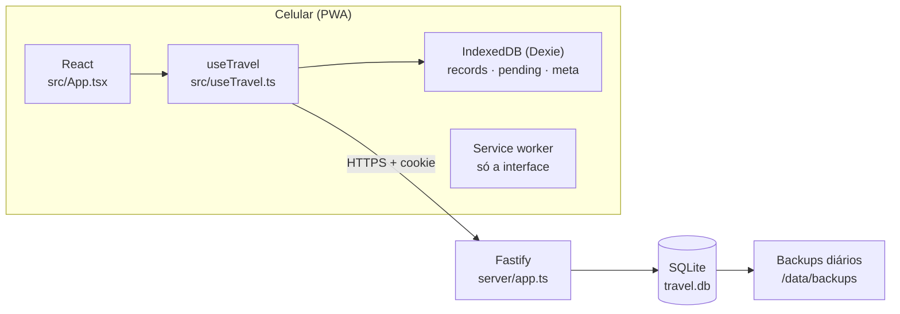
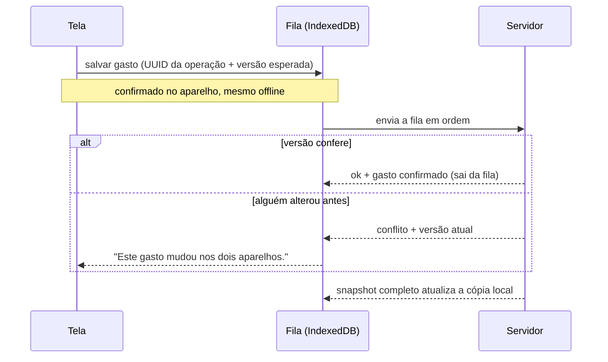

# Arquitetura

O app tem três partes que compartilham as mesmas regras:

- a **interface** (`src/`), que roda no celular e guarda uma cópia dos dados;
- o **servidor** (`server/`), que guarda a versão oficial num banco SQLite;
- o código **compartilhado** (`shared/`), com tipos, validação e cálculos usados pelos dois lados.

## Interface

| Arquivo | Responsabilidade |
|---|---|
| `src/App.tsx` | Telas (Visão geral, Gastos, Configurações), formulários, filtros, conflitos e exportação |
| `src/TripPace.tsx` | Gráfico "Ritmo da viagem": curva acumulada e linha do ritmo ideal |
| `src/LoginArt.tsx` | Ilustração em SVG da tela de entrada |
| `src/Amount.tsx`, `src/usePrivacy.ts` | Exibição de valores e o modo "ocultar valores", salvo por aparelho |
| `src/useTravel.ts` | Estado React, login, agendamento da sincronização |
| `src/store.ts` | IndexedDB, fila de alterações, sincronização e resolução de conflitos |
| `src/api.ts` | Cliente HTTP com tempo limite e erros tipados |
| `src/styles.css` | Tokens de cor e todos os estilos |

### Dinheiro, datas e cálculos

- Valores são sempre **centavos inteiros**; a conversão de texto como `1.200,00` acontece em `parseMoney` (`shared/model.ts`).
- Datas são `AAAA-MM-DD` no fuso `America/Sao_Paulo` (`today()`).
- `totals()` separa o que conta no orçamento do que foi pago com ticket.
- `dailyTotals()` e `paceSeries()` alimentam o gráfico.
- `shownMoney()` aplica a máscara de valores ocultos, sempre com o mesmo tamanho.

## Servidor

| Arquivo | Responsabilidade |
|---|---|
| `server/app.ts` | Rotas, autenticação, cabeçalhos de segurança e arquivos estáticos |
| `server/db.ts` | Abertura do banco, migrações, leitura e aplicação idempotente de operações |
| `server/index.ts` | Inicialização, backup na partida e a cada 24 horas, encerramento limpo |
| `server/account.ts`, `scripts/configure-account.mjs` | Criação e redefinição da conta |
| `server/backup.ts`, `server/restore.ts` | Backup consistente (14 cópias) e restauração |

### Modelo de dados (SQLite)

| Tabela | Colunas principais | Observações |
|---|---|---|
| `account` | `email`, `password_hash` | Uma única linha; senha com Argon2id |
| `sessions` | `token_hash`, `expires_at` | Uma por aparelho, 30 dias; só o hash do token fica no banco |
| `trip` | `start_date`, `end_date`, `budget_cents`, `ticket_budget_cents`, `version` | Uma única linha; `version` evita sobrescrever o orçamento alterado no outro aparelho |
| `expenses` | `description`, `amount_cents`, `category`, `date`, `note`, `paid_with_ticket`, `version`, `deleted`, `updated_at` | Exclusão é lógica (`deleted`), para um gasto apagado não "ressuscitar" vindo de outro aparelho |
| `operations` | `id`, `request`, `response` | Registro de cada operação recebida, para reenvios não duplicarem gastos |
| `schema_migrations` | `version`, `applied_at` | Migrações aplicadas |

O banco usa WAL e `busy_timeout`. As restrições do banco repetem as regras de negócio: valor positivo, categoria válida e ticket só em Alimentação.

### API

Todas as respostas da API usam `Cache-Control: no-store`. Escritas (`POST`/`PUT`) só são aceitas se o cabeçalho `Origin` for igual a `APP_ORIGIN`. Fora `health` e `login`, todas as rotas exigem sessão.

| Rota | Entrada | Resposta |
|---|---|---|
| `GET /api/health` | — | `{"status":"ok"}`, sem dados privados |
| `POST /api/login` | `email`, `password` | Cookie de sessão. Limite de 10 tentativas a cada 15 minutos |
| `GET /api/session` | — | E-mail da conta |
| `POST /api/logout` | — | Revoga a sessão deste aparelho |
| `GET /api/trip` | — | Viagem e todos os gastos, inclusive os excluídos logicamente |
| `PUT /api/budget` | `budgetCents` e/ou `ticketBudgetCents`, `expectedVersion` | Viagem atualizada, ou `409` se o orçamento mudou em outro aparelho |
| `POST /api/sync` | `operationId`, `entityId`, `expectedVersion`, `kind` (`upsert`/`delete`), `expense` | `{status:"ok", expense}` ou `{status:"conflict", current}` |

## Offline e sincronização

O IndexedDB tem três tabelas: `records` (a última cópia do servidor), `pending` (a fila de alterações deste aparelho) e `meta` (viagem, conta e horário da última sincronização). A tela sempre mostra a cópia do servidor **com as pendências aplicadas por cima**, então os totais já incluem o que ainda não foi enviado.

- **Quando sincroniza:** ao salvar, ao reconectar, ao voltar para o app e a cada 10 segundos com ele visível. O Web Locks evita duas abas sincronizando ao mesmo tempo.
- **Idempotência:** cada operação tem UUID. Se a resposta se perder e o aparelho reenviar, o servidor devolve a mesma resposta guardada em `operations`. Reutilizar o UUID com conteúdo diferente é recusado.
- **Conflitos:** se a versão esperada não bate, nada é sobrescrito. O gasto fica marcado e a pessoa escolhe a versão local ou a do outro aparelho. A escolha vira uma operação nova. Um conflito não trava os outros gastos.
- **Sessão expirada:** a fila é preservada e o app pede um novo login.
- **Sair da conta** exige internet e nenhuma pendência; os dados locais são apagados depois de revogar a sessão.

## Segurança

- Não existe cadastro público: a conta é criada pelo assistente no servidor, sem senha padrão no código.
- Senhas com Argon2id. Tokens de sessão aleatórios, guardados com hash, em cookie `HttpOnly`, `Secure` em produção e `SameSite=Strict`.
- Verificação de origem em todas as escritas e limite de tentativas no login.
- CSP restritiva e cabeçalhos de segurança (`X-Frame-Options`, `nosniff`, HSTS em produção).
- Os logs não registram corpo de gastos, senhas nem cookies.
- O service worker guarda apenas os arquivos da interface. Respostas da API nunca entram no cache.
- No Docker: usuário sem privilégios, `no-new-privileges`, todas as *capabilities* removidas e porta publicada só em `127.0.0.1`.
